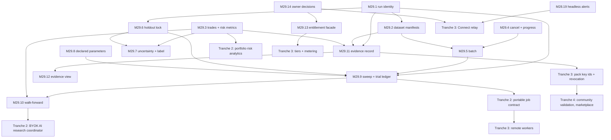

# Platform expansion assessment

Status: **proposal for owner review** (pairs with [M29](milestones/M29.md)).
Nothing here is work until the owner merges M29. Pricing, tiers, hosted
services and third-party spend are owner decisions; this document does not
make them.

This assessment compares the repository on `main` (2026-11-25, after
V1 10 / #622) against the commercial differentiation and platform expansion
brief. The code is the source of truth. File references are repo-relative.

## 1. Summary

1. **The engine is good at the hard parts.** Deterministic Decimal backtests,
   hashed receipts, holdout overlap refusal, a bounded research job queue,
   loopback auth, OS-keychain-only keys, outbox-before-send, paper-only
   release fence. The brief's integrity bar is mostly an extension of what
   exists, not a rewrite.
2. **Several research and commerce primitives are built but not wired.**
   `research/datasets.py`, `research/windows.py`, `research/experiments.py`,
   `strategy_ir/identity.py`, `packs/creator_signed.py`,
   `packs/rev_share_ledger.py` and `packs/launch_family.install_pack_bytes`
   have tests but no application caller. Wiring them is cheaper and safer
   than writing new parallel systems.
3. **Three entitlement models disagree.** The tick gate reads the signed
   license cache, checkout/refund writes SKU entitlements, and the legacy CLI
   keeps a plaintext key under `~/.krellbot`. This must be unified before any
   new tier (Plus/Pro) is added, or every new tier multiplies the drift.
4. **There is no AI provider, relay, or remote compute code at all.**
   Initiatives A (hosted part), B (remote), C, F (commerce) and G start from
   zero. They need owner decisions and infrastructure that this repository
   cannot supply.
5. **The brief's tier model conflicts with the current positioning.**
   [market-position.md](market-position.md) argues activity fees beat flat
   subscriptions; the brief proposes $19 / $39 monthly tiers. That is a
   business decision for the owner (M29.14), not an engineering default.

Recommended first tranche (M29): make every reported result reproducible and
honest (run identity, dataset manifests, risk metrics with reference
fixtures, complete trial ledgers, walk-forward), attach verifiable evidence to
packs, and unify entitlements. Delivering alerts without the UI open is
M28.19 (F17), after M28.1's per-occurrence dedupe. All of it is local,
free, V1-compatible, and is the foundation every paid service needs.

## 2. Capability gap matrix

Legend: **E** exists, **P** partial, **A** absent.

| Capability | Existing implementation | State | Architectural gap | Required change | Deps | Workstream |
| --- | --- | --- | --- | --- | --- | --- |
| Deterministic backtest | `backtest/engine.py` `Backtester.run`, `backtest/ledger.py`; `tests/test_backtest_engine.py`, `tests/test_m2_export_determinism.py` | E | Single position, long only, flat fee/slippage; doc drift on stop fill (`docs/backtest.md` says `min(stop, open[t+1])`, engine fills on the triggering bar) | Fix doc; keep engine | — | M29.3 |
| Run identity / receipt digest | `backtest/receipt.py` `build_receipt`; `api/jobs.py` computes `receipt_canonical_sha256` | P | Digest computed but `_extract_result` drops it; no single run id over pack + data + engine + params | Persist digest and a composed run id | — | M29.1 |
| Dataset versioning | `data/cache.py` content-addressed `datasets/imported/<stem>/<sha256>.csv`; `research/datasets.py` `DatasetManifest` (unwired) | P | Research receipts carry only a data hash, no coverage/gap manifest | Wire manifests and pinned windows into research | M29.1 | M29.2 |
| Data quality | `data/gaps.py` `check_gaps`, `dedupe`; candle readers refuse inconsistent OHLC | P | `cache._parse_csv` silently drops malformed rows | Count and report dropped rows in the manifest | M29.2 | M29.2 |
| Holdout / leakage | `research/holdout.py` `assert_disjoint`; `application/research.py` `prepare_v1` / `FutureData` | E | Holdout is only enforced per single run | Enforce across sweeps (selection never sees holdout) | M29.9 | M29.6, M29.9 |
| Parameter sweep / optimization | none (`grep sweep|optimi|grid` empty) | A | No multi-trial job | Bounded sweep job, every trial recorded | M29.1, M29.4, M29.8 | M29.9 |
| Walk-forward / OOS | none | A | — | Rolling train/test windows over the sweep | M29.9 | M29.10 |
| Multiple-testing awareness | `research/experiments.py` `record_trial` (unwired) | P | Trials not persisted, so trial count cannot be reported | Persist trial ledger; report trial count with every best result | M29.9 | M29.9 |
| Risk-adjusted metrics | `backtest/metrics.py` (total return, CAGR, max DD, exposure, per-year, buy-and-hold) | P | No Sharpe, Sortino, volatility, DD duration, profit factor, expectancy, fee impact; no hand-computed reference tests | Add with reference fixtures and `docs/metrics.md` | — | M29.3 (fee impact: M28.9, F01) |
| Portfolio analytics | `application/paper.py` `project_portfolio_history`, `GET /api/v1/portfolio/history`; `features/portfolio/PortfolioHistoryPanel.tsx` | P | Equity replay duplicates fee/equity maths outside `Ledger`; no risk statistics | Reuse M29.3 metric functions on paper equity | M29.3 | Tranche 2 |
| Research job lifecycle | `api/jobs.py` `JobManager` (1 running, 4 queued, persisted, `interrupted` on restart) | P | Runner ignores `cancel_event`; `progress` never set; no resume | Cooperative cancel + progress | — | M29.4 |
| Pack evidence | `docs/evidence.md` (install digest only); `features/paper/ForwardPaperLedgerPanel.tsx` | A | Catalogue rows carry no evidence; nothing binds evidence to pack bytes | Evidence record v1 bound to `pack_sha256` | M29.1, M29.2 | M29.11, M29.12 |
| Entitlements | `license.py` `entries_allowed` (tick gate, entries off / exits on); `application/checkout.py` SKU entitlements; legacy CLI `gate()` | P | Three models; refund revokes SKU but the tick gate reads the license cache | One read facade; documented lapse semantics | owner decision on lapse | M29.13 |
| Tiers (Plus / Pro), metering | `free` / `paid` only | A | No hosted-service entitlement type, no usage ledger | After M29.14 decisions | M29.13, M29.14 | Tranche 3 |
| Pack signing and provenance | ed25519 `license.verify_signed`; `packs/creator_signed.py`; both shipped keys are `# DEV` | P | No key ids, rotation, signer scoping, revocation; creator id dropped on install; `packs/creator/` not discovered | Key ids + revocation list + provenance kept on install | owner signing keys | Tranche 3 |
| Pack permissions | catalogue `permissions` shown in `PackLibrary.tsx` | P | Not enforced | Enforce declared permissions at install / arm | Tranche 3 | Tranche 3 |
| AI integration | `mcp/tools.py` `McpTools` (read, draft, validate, backtest, paper_arm), `application/user_policy.py` | P | Not a real MCP transport; no LLM client; no BYOK, metering or budgets | Local MCP stdio wrapper, then BYOK adapter with budgets; `JobManager` assumes a single owning process, so MCP job creation goes through the loopback API or a cross-process lock | M29.4, M29.9 | Tranche 2 |
| Alerts / notifications | `notifications.py` desktop + SMTP; `application/alerts.py` | P | `maybe_notify` runs only from `GET /api/v1/operations` (UI must be open) | Notify from the scheduled tick | — | M28.1, M28.19 (F17) |
| Remote access | `api/tailnet.py` `TailnetAccess` (full workstation over Tailscale) | P | No read-only scope, no device enrollment, no relay | Key-blind outbound relay after M28.19's scheduled-tick alerts | M28.19, M29.14 | Tranche 3 |
| Headless runner | `service/` renderers + supervisors, hourly one-shot `krellbot tick` | E | — | Reuse for alerts and research workers | — | — |
| Remote / cloud compute | none | A | No portable job contract | Portable job spec first (local workers), remote later | M29.9 | Tranche 2–3 |
| Marketplace | `community.py` allow-listed index; `packs/rev_share_ledger.py` (fake settlements, unwired) | P | No submission validation, no seller identity | Validation infra before commerce | Tranche 3 | Tranche 4 |
| Managed hosting | explicit non-goal (`docs/threat-model.md`, `PARKING.md`) | A | Custody redesign required | Parked | — | Not scheduled |
| Telemetry | `telemetry.py` opt-in; `FUNNEL_EVENTS` | E | `backup_completed` event is undocumented in `docs/telemetry.md` | Parked (one line) | — | PARKING |

## 3. Weighted prioritization

Scores are 1–10 (higher is better). Weights: differentiation 20%, revenue 20%,
user value 15%, open-source/security alignment 15%, architectural readiness
10%, delivery efficiency 10%, retention 10%.

| Feature | Diff | Rev | User | Align | Ready | Eff | Ret | **Score** |
| --- | --: | --: | --: | --: | --: | --: | --: | --: |
| Strategy evidence + provenance (E) | 8 | 8 | 8 | 10 | 7 | 8 | 7 | **8.10** |
| Local risk-adjusted analytics (D) | 7 | 5 | 9 | 10 | 9 | 9 | 8 | **7.85** |
| Research job lifecycle (A foundation) | 7 | 6 | 7 | 9 | 8 | 8 | 7 | **7.30** |
| Sweeps + walk-forward with trial ledger (A integrity) | 8 | 6 | 7 | 9 | 6 | 6 | 7 | **7.10** |
| Agentic research w/ BYOK AI (A) | 10 | 8 | 7 | 6 | 3 | 4 | 8 | **7.05** |
| Connect read-only monitoring (C) | 7 | 8 | 7 | 6 | 4 | 5 | 9 | **6.75** |
| Pack signing / provenance tooling (F foundation) | 7 | 6 | 5 | 10 | 6 | 7 | 5 | **6.65** |
| Entitlement unification (§13) | 4 | 8 | 5 | 9 | 6 | 7 | 8 | **6.60** |
| Portable job contract + local workers (B foundation) | 5 | 4 | 6 | 9 | 6 | 7 | 5 | **5.85** |
| Marketplace commerce (F) | 7 | 7 | 4 | 6 | 3 | 2 | 6 | **5.40** |
| Hosted distributed compute (B) | 6 | 6 | 5 | 6 | 3 | 3 | 5 | **5.15** |
| Premium datasets (H) | 4 | 5 | 5 | 7 | 4 | 3 | 5 | **4.80** |
| Managed hosting (G) | 4 | 7 | 5 | 2 | 1 | 1 | 7 | **4.15** |

Entitlement unification scores in the middle but goes first among commercial
work: it is a correctness prerequisite for every paid tier.

Risks the scores do not capture:

| Feature | Security | Regulatory | External deps | Demand unvalidated | Infra cost | Maintenance | V1 impact |
| --- | --- | --- | --- | --- | --- | --- | --- |
| Agentic research | untrusted generated packs; prompt injection via data | low | LLM providers | yes | inference (metered) | high | none if post-V1 |
| Connect | new remote attack surface | low | relay hosting | partly | low–medium | medium | none |
| Hosted compute | multi-tenant untrusted packs | low | cloud provider | yes | high | high | none |
| Marketplace | malicious packs; seller fraud | medium (payments, tax, KYC) | processor | yes | medium | high | none |
| Managed hosting | custody of keys | high | cloud provider | yes | high | very high | must not touch V1 |
| Exchange partnerships | conflict of interest | medium | exchanges | partly | low | low | none |

## 4. Dependency graph

## 5. Architecture decisions

Proposed ADRs (status **Proposed** until the owner merges):

- [0002 — Commercial entitlements never gate local engine capability](adr/0002-entitlements-separate-from-local-authorization.md)
- [0003 — Research is a deterministic engine coordinated, not computed, by AI](adr/0003-deterministic-research-ai-coordinator.md)
- [0004 — Hosted services are key-blind and outbound-only](adr/0004-hosted-services-key-blind-outbound-only.md)

## 6. Revised backlog

The brief's PR-01…PR-15 workstreams map onto tranches. Only tranche 1 is
written as tasks (M29; its alert item moved to M28.1 and M28.19). Later tranches become
milestone proposals after tranche 1 lands and the owner decides M29.14.

| Brief PR | Tranche | Where | Classification |
| --- | --- | --- | --- |
| PR-01 audit + roadmap | 1 | this file + M29 | Foundation |
| PR-03 evidence + provenance | 1 | M29.1, M29.2, M29.11 | V1-compatible foundation |
| PR-04 evidence presentation | 1 | M29.12 | V1 (Advanced surface only) |
| PR-05 research job lifecycle | 1 | M29.4 | V1-compatible foundation |
| PR-06 (integrity half) | 1 | M29.5–M29.10 | Post-V1 local, no services |
| PR-08 (metric half) | 1 | M29.3 | V1-compatible foundation |
| PR-02 entitlements | 1 | M29.13 (after M29.14) | V1-critical correctness |
| PR-09 (local half) | 1 | M28.1, M28.19 (F17) | V1-compatible foundation |
| PR-06 (AI half), PR-07 | 2 | BYOK coordinator, budgets | Post-V1 revenue accelerator |
| PR-08 (portfolio half) | 2 | portfolio risk analytics | Post-V1 |
| PR-10 | 2 | portable job contract, local process pool | Post-V1 |
| PR-09 (hosted half) | 3 | Connect relay, device enrollment | Post-V1 revenue |
| PR-11 | 3 | remote workers, compute metering | Post-V1 (demand-gated) |
| PR-12 | 3 | pack key ids, revocation, provenance | Platform expansion |
| PR-13 | 4 | community validation infra | Platform expansion |
| PR-14 | 4 | marketplace commerce | V2 (demand-gated) |
| PR-15 | — | managed hosting | Not scheduled (custody redesign) |

## 7. V1 protection

- M29 does not touch the first-run wizard, the paper-arm path, live
  qualification (M27), or `PAPER_ONLY_RELEASE`.
- New metrics and evidence appear only behind **More / Advanced** surfaces.
  Strategy explanations keep their rule of no `% return`, `% profit` or
  `win rate` copy (`StrategyExplanation.test.tsx`).
- No new service is reachable from a default install. No new egress is
  added in tranche 1.
- M27 and M28 stay ahead of M29. Agents finish their agent tasks first
  unless the owner reorders.
- Risk-path tasks (M29.11, M29.13) carry the `risk-path` label and owner review.

## 8. Commercial and operational risk

**Unit economics (model, not numbers).** Every hosted offer must state, before
launch, a measured cost per unit and a hard per-account cap:

| Service | Cost driver | Unit to meter | Required guardrail |
| --- | --- | --- | --- |
| Hosted AI research | inference tokens | tokens per job, jobs per month | prepaid allowance; job refused when the budget is reached; BYOK never metered |
| Cloud backtest | CPU-seconds, storage, egress | CPU-seconds per trial | estimate before run, spend cap, artifact retention limit |
| Connect | relay connections, event storage | devices, events per day | event retention window; no trading data without consent |
| Maintained strategies | research staff, data licensing | — (content) | evidence page per pack; lapse = entries off, exits on |
| Premium data | licence fees | GB synced | redistribution rights verified first |

Gross margin per tier = price − (payment processing + Σ metered cost at the
cap + support + security/ops allocation). A tier is launchable only if that
margin is positive **at the cap**, not at average use.

**Risks.**

- *Positioning.* Flat tiers contradict [market-position.md](market-position.md).
  Owner decides (M29.14).
- *Trust.* Any hosted surface that sees trading data weakens the "krellbot.dev
  never receives keys" pitch. ADR 0004 keeps keys and order authority local.
- *Integrity.* Optimization without a complete trial ledger produces
  cherry-picked results. M29.9 records every trial, including failures.
- *Regulatory.* Marketplace payouts, data resale and managed hosting need
  legal review. None are scheduled in tranche 1.
- *Operational.* Hosted services need on-call, incident response and backups
  that do not exist today. They stay demand-gated.

## 9. Immediately executable

Once the owner merges M29 and M28's agent tasks have landed, the
dependency-ready agent tasks are **M29.1**, **M29.4** and **M29.8** (owner
review). They can run in parallel. M29.13 waits for the owner's lapse
decision in M29.14.
